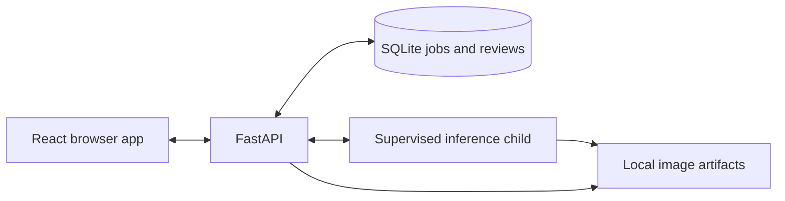

# Defect Lens

A local computer vision app for inspecting a tabletop assembly. Upload an image, compare it with a known-good reference, inspect the anomaly overlay and record a human correction without losing the original result.

Built with **Python, FastAPI, SQLite, OpenCV, PyTorch and React/TypeScript**. Runs on CPU; the default demo needs no account, API key or model download.


## What it does

The sample object is a gray plate with four dark fasteners. Defect Lens checks for a missing fastener or an unexpected surface mark. A blurred or badly framed image goes to review instead of receiving a confident pass or fail.

Two methods share the same alignment and evaluation pipeline:

- **Aligned difference:** compares an image with a median reference built from good training images.
- **Pretrained patch features:** compares ResNet18 feature vectors with a bank of good examples.

Each inspection keeps its model revision, score, images and explanation. Corrections are versioned separately, so the original decision remains available after a restart.

## Results

The comparison used 90 held-out **procedural images** per method: 36 good, 36 with known defects and 18 ambiguous. Both methods detected all 36 labelled defects with no false rejects. The simpler difference method needed fewer reviews and localized the generated defects more accurately.

| Measure | Aligned difference | ResNet18 patch features |
| --- | ---: | ---: |
| Images requiring review | 21/90 (23.3%) | 54/90 (60.0%) |
| Mean defect-mask intersection over union | 1.000 | 0.213 |
| Mean per-image pixel average precision | 1.000 | 0.293 |
| Warm pipeline latency, 95th percentile | 16.51 ms | 32.29 ms |

Measured on an Apple M5 Pro with 24 GiB RAM, using CPU inference. Pipeline latency includes decoding, alignment, scoring and artifact storage. The [full report](reports/fixture-v1/report.md) includes raw predictions, split and model hashes, memory measurements and timing scope.

These images are deliberately simple. Actual pretrained inference has run, but **no photographic accuracy study has been performed**. The results support the reproducible demo; they do not establish industrial inspection performance.

## Run locally

Requires uv, Python 3.12 and Node 24. Process management targets macOS and Linux.

```bash
git clone https://github.com/rbtbuilds/defect-lens.git
cd defect-lens
uv sync --locked
npm --prefix web ci
uv run defect-lens fixtures --output .runtime/data/fixtures --seed 20261015
uv run defect-lens prepare --method difference --dataset .runtime/data/fixtures/manifest.json --output .runtime/models/demo-difference
uv run python scripts/dev.py start --model .runtime/models/demo-difference
```

Open **http://127.0.0.1:5111**. Upload a PNG from `.runtime/data/fixtures`, inspect the result, then save a correction. Validation/test filenames ending in `-0` or `-1` are good views; `-2` is a missing fastener, `-3` a staged mark and `-4` a blurred image.

The API uses port 8111 and the browser app uses 5111. Both bind to loopback. Generated images, model files, logs and the database stay in ignored `.runtime/` storage.

```bash
uv run python scripts/dev.py status
uv run python scripts/dev.py stop
```

The [runbook](docs/RUNBOOK.md) covers optional pretrained setup, batch inspection, storage limits and recovery. The tested local environment used Node 26.7.0 as a documented compatibility exception; CI targets Node 24.

## Engineering choices

- **Compare against a simple baseline.** Validation freezes the thresholds before the held-out comparison. The measured review burden supports using aligned difference as the default.
- **Preserve decisions and feedback.** SQLite transactions protect job admission, result completion and append-only corrections. Retries reuse their request identity; stale correction versions fail explicitly.
- **Bound the work.** One supervised inference child has a 30-second deadline, a memory ceiling and one restart budget. Upload size, queue length and retained storage are capped.
- **Make results traceable.** Model revisions include source, dependency, data, configuration and artifact hashes. A changed inference implementation requires a new prepared revision.



For design details and trade-offs, read the [engineering case study](docs/CASE-STUDY.md), [specification](docs/SPEC.md) or [API contract](docs/api/openapi.json).

## Tests

```bash
uv sync --locked --extra features
npm --prefix web exec -- playwright install chromium
uv run python scripts/verify.py --fixture-only
```

The verification command runs Ruff, frontend lint, strict Pyright and TypeScript checks, Python and browser-component tests, the production build, Playwright against the real API and an interrupted-worker/restart scenario. Stop this project's servers first. To verify independent dependencies and generated data from committed source:

```bash
uv run python scripts/clean_clone.py
```

The [verification record](docs/STATE.md) lists exact outcomes and the [review record](docs/REVIEW.md) records findings and fixes. Screen-reader testing remains unperformed.

## Scope and licence

This is a single-operator local application for a controlled overhead view. Camera integration, authenticated teams, cloud hosting, automatic retraining and per-job cancellation are outside v1. See [security and limits](SECURITY.md).

Original code, documentation and procedural images are [MIT licensed](LICENSE). Third-party weights and training data retain their own terms; no weights or external image datasets are redistributed. Contributions are covered in [CONTRIBUTING.md](CONTRIBUTING.md).
