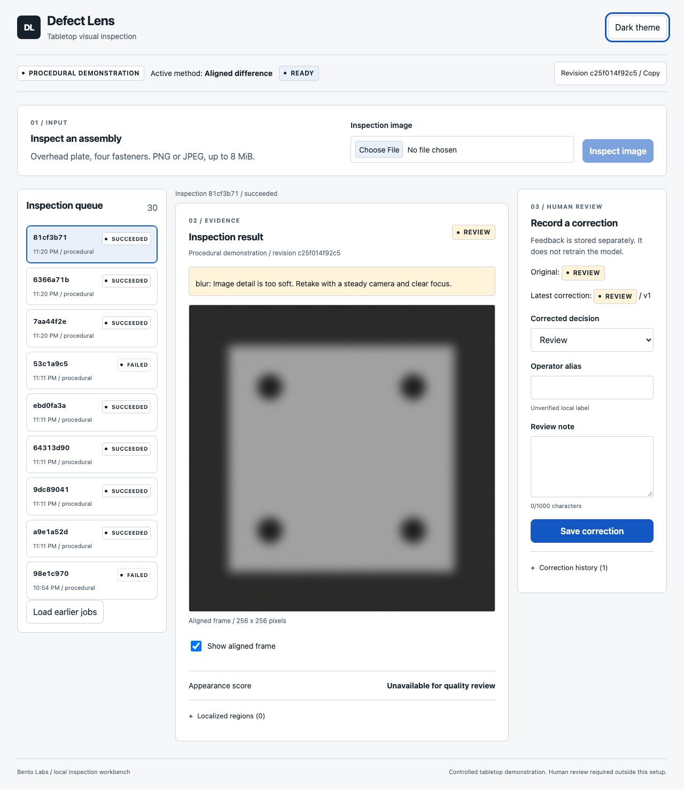

# Defect Lens

A local visual inspection workbench for a matte gray tabletop plate with four dark fasteners. Upload an image, inspect appearance differences, review uncertainty and record a correction that preserves the original model decision.



The account-free sample uses original procedural images. The default aligned difference method runs offline; a separate ResNet18 IMAGENET1K_V1 patch baseline executes actual pretrained inference when its public checkpoint and the machine lease are available. No owned photographs or industrial accuracy are claimed. This portfolio piece demonstrates vision integration, deployment constraints, evaluation and operator handoff.

## Quickstart

From this repository's Git root, with uv, Python 3.12 and Node 24 available:

```bash
uv sync --locked --extra features
npm --prefix web ci
uv run defect-lens fixtures --output .runtime/data/fixtures --seed 20261015
uv run defect-lens prepare --method difference --dataset .runtime/data/fixtures/manifest.json --output .runtime/models/demo-difference
uv run python scripts/dev.py start --model .runtime/models/demo-difference
```

Open http://127.0.0.1:5111 . Choose a PNG from .runtime/data/fixtures: filenames ending -0/-1 are good, -2 missing-fastener, -3 staged mark and -4 blurred quality examples in validation/test. Upload, inspect and save a correction. No model download, cloud key or paid compute is needed for this sample after dependency installation. This Mac's tested local exception is Node 26.7.0; CI targets 24.

```bash
uv run python scripts/dev.py status
uv run python scripts/dev.py stop
```

Reserved ports are API8111/web5111. An occupied port causes refusal; inspect its owner before taking action. The helper stops only processes whose recorded PID/start identity matches. All generated data, SQLite state, models and logs remain in ignored .runtime.

## Architecture and evidence

React/TypeScript/Vite -> local FastAPI -> transactional SQLite queue -> one supervised CPU inference child -> versioned score/overlay -> append-only human review. Quality checks and ECC alignment are shared by both scorers. Calibration uses validation only; held-out samples never refit thresholds. Source, dependency, training/validation, artifact and configuration hashes define immutable model revisions. Corrections retain the original decision and revision.

The API bounds upload size, queue capacity, retained storage, job time and worker RSS. A crash marks interrupted running work failed and retains queued work. No automatic retraining or per-job cancel is provided.

- [Evaluation design and measured evidence](EVALUATION.md)
- [Model card and limitations](docs/MODEL-CARD.md)
- [Owned-photo status](reports/owned-capture-status.md) and [capture recipe](docs/CAPTURE-GUIDE.md)
- [Engineering case study](docs/CASE-STUDY.md) and [two-minute walkthrough](docs/WALKTHROUGH.md)
- [Runbook: setup, optional features, batch, quotas, lease and recovery](docs/RUNBOOK.md)
- [Exported OpenAPI](docs/api/openapi.json), [specification](docs/SPEC.md) and [verification state](docs/STATE.md)

## Observed procedural comparison

Each method processed 90 held-out images: 36 good, 36 known defects and 18 ambiguous. Both detected all labelled defects without false rejects. Difference required 23.3% reviews versus 60.0% for the pretrained patch method, with mean mask IoU 1.000 versus 0.213 and warm pipeline p95 of 16.51 ms versus 32.29 ms. See the [full report](reports/fixture-v1/report.md) for hashes, timing scope, raw rows and limits. These easy procedural results cannot establish photographic accuracy.

## Verification

Stop owned servers before checks; then:

```bash
npm --prefix web exec -- playwright install chromium
uv run python scripts/verify.py --fixture-only
uv run python scripts/clean_clone.py
```

The clean-clone check requires clean committed source and creates an independent local clone under .runtime. It tests strict Python/TypeScript, unit/integration checks, build, actual browser uploads/corrections and interrupted-worker restart. It performs no push or publication. Screen-reader testing has not been performed.

## Scope and licence

One object, controlled overhead view, file input and human review. Webcam/industrial cameras, line controls, cloud hosting, authenticated teams and automatic training are outside v1. Procedural data cannot establish performance on photographs or uncontrolled production environments. No customer pilot or simulated time-saving claim is made.

Original code/docs/procedural images: [MIT](LICENSE). Third-party model/data terms remain separate; no external benchmark assets or weights are redistributed. See [contributing](CONTRIBUTING.md), [security](SECURITY.md) and [changelog](CHANGELOG.md).
